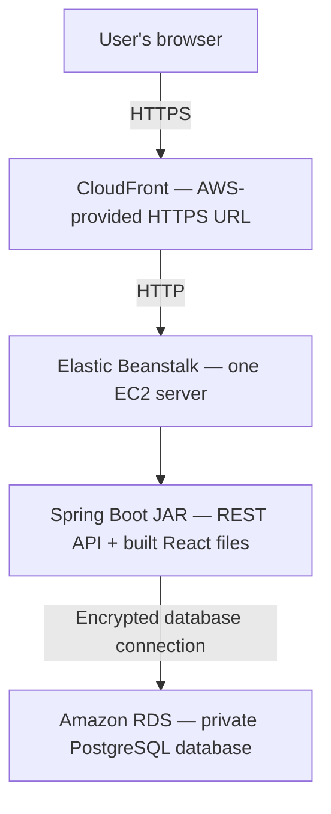

# Beginner AWS deployment plan for BankOfCLI

## 1. What we’re building

Deploy your React frontend and Spring Boot backend together as **one executable Java application**, with PostgreSQL hosted separately in Amazon RDS.

Based on your choices, this will be:

- A public portfolio demo using fictional banking data.
- Hosted in **US East (Ohio), `us-east-2`**.
- Funded by new-account AWS credits, then removed before paid usage.
- Accessible through an AWS-provided HTTPS address.
- Deployed manually through the AWS Console for your first launch.



**CloudFront** provides the public HTTPS entrance. **Elastic Beanstalk** manages the application server. **RDS** manages PostgreSQL.

For this inexpensive demo, the CloudFront-to-Beanstalk connection uses HTTP. Browser traffic uses HTTPS, but this is **not end-to-end TLS**. Use disposable passwords and fictional data throughout. [AWS origin protocol documentation](https://docs.aws.amazon.com/AmazonCloudFront/latest/DeveloperGuide/RequestAndResponseBehaviorCustomOrigin.html)

### Expected cost before credits

Using approximately 730 hours per month:

| Resource | Starting configuration | Estimated monthly cost |
|---|---|---:|
| Application server | EC2 `t3.micro` | $7.59 |
| Application disk | 10 GiB gp3 | $0.80 |
| Public IPv4 address | One address | $3.65 |
| PostgreSQL server | RDS `db.t4g.micro`, Single-AZ | $11.68 |
| Database storage | 20 GiB gp3 | $2.30 |
| **Baseline total** | | **About $26/month** |

Allow additional room for logs, backups, traffic, taxes, and other usage. These estimates come from the current [Ohio EC2 catalog](https://pricing.us-east-1.amazonaws.com/offers/v1.0/aws/AmazonEC2/current/us-east-2/index.csv), [Ohio RDS catalog](https://pricing.us-east-1.amazonaws.com/offers/v1.0/aws/AmazonRDS/current/us-east-2/index.json), [EBS pricing](https://aws.amazon.com/ebs/pricing/), and [IPv4 pricing](https://aws.amazon.com/vpc/pricing/).

Eligible new customers currently receive **$100 in initial credits**, with opportunities to earn another $100. The AWS Free account plan ends after six months or credit exhaustion, whichever comes first. Your plan will remain on that account type and use a **60-day initial demo period**, with earlier teardown if credits fall below $20. [AWS Free Tier details](https://aws.amazon.com/free/free-tier-faqs/)

## 2. Prepare the application before creating paid resources

The project includes the configuration and packaging described below. This section explains how the release works and how to prepare your local machine before building it.

### Make frontend requests work in the cloud

[apiClient.ts](frontend/src/services/apiClient.ts) uses relative URLs for production requests.

For example, the browser should request:

```text
https://your-distribution.cloudfront.net/user/accounts
```

An API URL containing `http://localhost:8080` in production would send requests to the visitor’s computer.

Preserve the existing API paths:

- `/auth` and `/auth/register`
- `/user/**`
- `/transaction/**`

Configure Vite’s development proxy for those paths so local frontend development still reaches Spring Boot on port 8080. Leave the production API base empty.

### Allow Spring Boot to serve React

[SecurityConfig.java](backend/src/main/java/com/example/bankofcli/infrastructure/security/SecurityConfig.java) allows anonymous access to:

- `/` and `/index.html`
- `/assets/**` and other actual frontend assets
- `/actuator/health`
- Existing login and registration endpoints

Banking endpoints must continue requiring a valid JWT.

Your app currently changes views using React state; it **doesn’t use React Router**. No SPA fallback controller is required. Unknown API requests and missing assets must retain their normal error responses.

Remove the hardcoded localhost `@CrossOrigin` annotations from all three controllers and centralize CORS configuration. Add one production setting, `APP_ALLOWED_ORIGIN`, containing the exact CloudFront HTTPS origin. This matters because CloudFront forwards the browser’s `Origin` header while replacing the origin-server hostname.

### Add a production configuration

Create a `prod` Spring profile that:

- Reads database settings and JWT secrets from environment variables.
- Runs on port **5000**, matching Beanstalk’s Java SE proxy.
- Uses INFO console logging.
- Disables SQL logging and the unbounded local log file.
- Logs operation outcomes without logging balances, transaction details, or authentication values.
- Exposes only the health endpoint, without detailed internal information.

Keep local development settings available separately. [AWS Java deployment guidance](https://docs.aws.amazon.com/elasticbeanstalk/latest/dg/java-quickstart.html)

### Make database creation repeatable

Add Spring Boot’s Flyway starter and PostgreSQL Flyway module. Create an initial migration matching the existing entities.

Production will:

1. Connect to a **new, empty** RDS database.
2. Run the initial migration.
3. Use Hibernate’s `ddl-auto=validate` to check the schema.

Disable Flyway in the existing local and test profiles so it doesn’t collide with your current Hibernate-managed databases. This first deployment will not import local data. [Spring database initialization guidance](https://docs.spring.io/spring-boot/how-to/data-initialization.html)

### Automate the release build

Add a root-level `scripts/package-eb.sh` script that:

1. Verifies Java 21 and the pinned Node version.
2. Runs `npm ci`, frontend lint, tests, and build.
3. Runs Maven verification using an isolated local test database.
4. Includes `frontend/dist` under the JAR’s classpath `static/` directory through a Maven cloud-packaging profile.
5. Copies the executable JAR into a clean release directory as `application.jar`.
6. Downloads the public RDS CA certificate bundle.
7. Produces a deployment ZIP with this layout:

```text
application.jar
Procfile
certs/rds-ca-bundle.pem
```

Use this `Procfile`:

```text
web: java -XX:MaxRAMPercentage=50.0 -jar application.jar
```

Keep generated frontend files and release archives out of Git. The ZIP must contain these files directly at its root. [AWS Java SE packaging](https://docs.aws.amazon.com/elasticbeanstalk/latest/dg/java-se-platform.html)

**Local acceptance gate:** run the packaged application without Vite. Confirm that the frontend loads, authentication works, and banking operations reach the local test database.

### Select Java 21 and enable local Docker access

The script requires a Java 21 **JDK**, even when a newer Java version is installed. On this Ubuntu setup, select the installed Java 21 JDK in the terminal where you will run the script:

```bash
export JAVA_HOME=/usr/lib/jvm/java-21-openjdk-amd64
export PATH="$JAVA_HOME/bin:$PATH"
java -version
javac -version
```

Both version commands should report Java 21. These exports apply to the current shell; repeat them in a new shell if its default is Java 25.

The script starts a temporary PostgreSQL container for backend integration tests. Start Docker if needed:

```bash
sudo systemctl start docker
docker info
```

If `docker info` reports permission denied, add your account to the Docker group and activate that membership:

```bash
sudo usermod -aG docker "$USER"
newgrp docker
```

`newgrp` opens another shell with a similar prompt and normally prints nothing. Run `groups` and `docker info` there: `docker` should appear in the group list and the server details should load without `sudo`. Then select Java 21 as above and run:

```bash
./scripts/package-eb.sh
```

The finished release is **`release/bankofcli-eb.zip`**. Its `application.jar` contains both the backend and built frontend: the Maven `cloud-package` profile copies `frontend/dist` into the JAR's static resources. The script sets the temporary database's Spring datasource username and password directly so imported developer settings cannot substitute local PostgreSQL credentials. It removes the test container on exit and replaces the generated `release/` directory on a successful build.

## 3. Set up AWS, step by step

### Step 1: Create and secure your account

1. Create an AWS account and select the **Free account plan**.
2. Enable multifactor authentication.
3. Use a separate administrator sign-in for everyday work.
4. Select **Ohio — `us-east-2`** in the Console’s region selector.
5. Open **Billing → Credits** and confirm your available balance and expiration.
6. Record your planned teardown date: 60 days after launch.

Create a $10 monthly budget with email notifications at $1, $5, and $10 of charges after credits. Also check credit consumption weekly.

A budget sends notifications; it is not a hard spending cap. Remaining on the Free account plan is the main protection for this credits-first deployment. [AWS Budgets behavior](https://docs.aws.amazon.com/cost-management/latest/userguide/budgets-managing-costs.html)

### Step 2: Create two security groups

A **VPC** is your AWS network. Use the existing default VPC for both the application and database.

A **security group** is a firewall attached to an AWS resource.

Create both groups together from the repository’s CloudFormation template, [`deploy/security-groups.yaml`](deploy/security-groups.yaml):

1. In **CloudFormation**, choose **Create stack → With new resources (standard)**.
2. Upload `deploy/security-groups.yaml` and name the stack `bankofcli-security-groups`.
3. For **VpcId**, select the default VPC in `us-east-2`.
4. In **VPC → Managed prefix lists**, find `com.amazonaws.global.cloudfront.origin-facing` and copy its ID for `us-east-2`.
5. Enter that ID as **CloudFrontOriginFacingPrefixListId**.
6. Create the stack and wait for `CREATE_COMPLETE`.
7. In the stack’s **Outputs**, record the application and database security group IDs for the later Beanstalk and RDS steps.

The template creates `bankofcli-app-sg` and `bankofcli-db-sg` in the selected VPC. It allows TCP port 80 to the application group from the CloudFront origin-facing managed prefix list, and PostgreSQL port 5432 to the database group from the application group. The application group retains the VPC’s default outbound access.

| Security group | Incoming traffic allowed |
|---|---|
| `bankofcli-app-sg` | TCP port 80 from AWS’s CloudFront origin-facing managed prefix list |
| `bankofcli-db-sg` | PostgreSQL port 5432 from `bankofcli-app-sg` |

The template already creates these rules; the table describes the result. You do not need to create the same rules manually. For the template's prefix list parameter, use the **ID beginning with `pl-`** of the list named:

```text
com.amazonaws.global.cloudfront.origin-facing
```

Keep default outbound access so the application server can reach AWS services. The prefix list permits CloudFront infrastructure generally; it doesn’t identify only your distribution. Its single rule consumes 55 entries of the default 60-entry security-group quota. [AWS managed prefix lists](https://docs.aws.amazon.com/vpc/latest/userguide/working-with-aws-managed-prefix-lists.html)

### Step 3: Create PostgreSQL in RDS

Open **RDS → Databases → Create database → Standard create**.

Use these settings:

| Setting | Value |
|---|---|
| Engine | PostgreSQL 18, latest available minor version |
| Deployment | Single-AZ DB instance |
| Identifier | `bankofcli-db` |
| Instance class | `db.t4g.micro` |
| Storage | 20 GiB gp3 |
| Storage autoscaling | Disabled for this temporary demo |
| Initial database name | `bankofcli` |
| Master username | `bankadmin` |
| Password management | Self managed; choose and securely save a strong password |
| VPC | Same default VPC as the application |
| Public access | **No** |
| Security group | `bankofcli-db-sg` |
| Encryption | Enabled |
| Backup retention | One day |
| Deletion protection | Enabled until teardown |

Create RDS independently from Beanstalk so replacing the application environment doesn’t delete the database.

During creation, expand **Additional configuration → Database options** and enter **`bankofcli`** as the initial database name. The RDS instance identifier `bankofcli-db` names the server; it does not create a PostgreSQL database named `bankofcli` by itself.

In the connectivity settings, select **only `bankofcli-db-sg`** for this deployment. Once RDS is available, open **Connectivity & security** and verify that group is attached. Its PostgreSQL inbound rule must allow port **5432** from **`bankofcli-app-sg`**. Leaving only the VPC's `default` group attached caused the app's database connections to time out during the first deployment. To fix an existing instance, choose **Modify → Connectivity → VPC security groups**, select `bankofcli-db-sg`, remove `default`, and save the change.

Wait for the database status to become **Available**, then record its endpoint. Open **Connectivity & security → Connect using → Endpoints** and copy the endpoint hostname. It also appears inside the quotes after `export RDSHOST=` in the connection snippets. Use the hostname without a URL scheme or port. Your laptop won’t connect directly to this private database; the application server will. [AWS private RDS access](https://docs.aws.amazon.com/AmazonRDS/latest/gettingstartedguide/security-public-private.html)

#### If RDS generated and manages the password

The Parameter Store setup below uses a self-managed RDS password. If you selected **Manage master credentials in AWS Secrets Manager**, switch the existing database to match this plan:

1. Open **RDS → Databases → bankofcli-db → Modify**.
2. Under **Credentials settings**, choose **Self managed** and set a strong new master password.
3. Save it securely, choose **Continue**, review the changes, and apply them.
4. When the password change finishes, store that same password in `/bankofcli/demo/DB_PASSWORD` in Step 4.

If the application is already deployed, update its Parameter Store value and restart the Beanstalk app server so it retrieves the new password. [RDS password management](https://docs.aws.amazon.com/AmazonRDS/latest/UserGuide/rds-secrets-manager.html)

#### If the `bankofcli` database was not created

The startup error **`FATAL: database "bankofcli" does not exist`** means the server is reachable but the application database is missing. Create it before deploying the application, or use these steps to recover an existing deployment:

1. Open **AWS CloudShell** using the terminal icon in the Console's top navigation bar. Confirm the region is **Ohio (`us-east-2`)**.
2. Click the **`+` beside the terminal tab → Create VPC environment**. This is an option inside CloudShell, not a separate AWS service.
3. Enter **Name:** `bankofcli-db-setup`; select the **same VPC as RDS**, any subnet in that VPC, and **Security group:** `bankofcli-app-sg`.
4. Choose **Create** and wait for the new terminal. That security group gives this temporary shell the database access allowed by `bankofcli-db-sg`.
5. Replace `YOUR_RDS_ENDPOINT` in the command below with the endpoint hostname and run it in the **new VPC environment terminal**:

```bash
psql "host=YOUR_RDS_ENDPOINT port=5432 dbname=postgres user=bankadmin sslmode=require" -W
```

6. Enter the RDS password when prompted. At the PostgreSQL prompt, create the application database:

```sql
CREATE DATABASE bankofcli;
```

7. Exit the PostgreSQL session:

```text
\q
```

8. Keep the application's JDBC URL pointing to `/bankofcli`. If it was already deployed, choose **Beanstalk → bankofcli-demo → Actions → Restart app server**. Flyway creates the tables on successful startup.
9. Delete the temporary CloudShell VPC environment when finished. The database remains in RDS.

Use the VPC environment for this private connection; ordinary CloudShell is outside your VPC. Keep the application's JDBC `sslmode=verify-full` settings from the later deployment step. [CloudShell VPC environments](https://docs.aws.amazon.com/cloudshell/latest/userguide/using-cshell-in-vpc.html), [AWS private PostgreSQL connection tutorial](https://docs.aws.amazon.com/hands-on/latest/connect-to-private-amazon-rds-for-postgresql-from-aws-cloudshell/connect-to-private-amazon-rds-postgresql-database-using-aws-cloudshell.html)

### Step 4: Store secrets

Open **Systems Manager → Parameter Store**. Create two **Standard**, **SecureString** parameters using the default AWS-managed encryption key:

```text
/bankofcli/demo/DB_PASSWORD
/bankofcli/demo/JWT_SECRET
```

For **`DB_PASSWORD`**, the parameter value is the actual RDS master password for `bankadmin`. The name `/bankofcli/demo/DB_PASSWORD` identifies where that password is stored; it is not itself the password.

Generate the JWT secret locally with:

```bash
openssl rand -base64 32
```

Store the result securely and keep it stable between releases. Changing it invalidates existing tokens.

Open each saved parameter and copy its **ARN** for the IAM policy and Beanstalk environment secret configuration. The ARN identifies the parameter; Beanstalk retrieves its secret value at startup.

Standard parameters at standard throughput have no additional Parameter Store charge. [Parameter Store pricing](https://aws.amazon.com/systems-manager/pricing/)

### Step 5: Create Beanstalk roles and the environment

Beanstalk needs two IAM roles:

- A **service role**, allowing Beanstalk to manage its infrastructure.
- An **EC2 role**, passed to your server through an **instance profile**, allowing it to retrieve deployment files, write logs, and read the two parameters.

#### Create the EC2 instance role

1. Open **IAM → Roles → Create role**.
2. For **Trusted entity type**, select **AWS service**.
3. For **Service or use case**, select **EC2**, then choose **Next**.
4. Search for and select the AWS-managed policy **`AWSElasticBeanstalkWebTier`**.
5. Choose **Next**, name the role **`bankofcli-ec2-role`**, and choose **Create role**.
6. Open the role's **Trust relationships** tab and confirm the trusted service is `ec2.amazonaws.com`.

Creating an EC2 role through IAM also creates an instance profile with the same name. Select that profile when configuring Beanstalk below. The web-tier policy provides the standard permissions for this Java web application. [Instance profile instructions](https://docs.aws.amazon.com/elasticbeanstalk/latest/dg/iam-instanceprofile.html)

#### Allow the instance role to read the two parameters

1. In **Systems Manager → Parameter Store**, open each parameter from Step 4 and copy its **ARN** from its details.
2. Open **IAM → Roles → bankofcli-ec2-role → Permissions**.
3. Choose **Add permissions → Create inline policy**, then select the **JSON** editor.
4. Paste the policy below. Replace both example ARNs with the ARNs you copied; `123456789012` is an example AWS account ID.

```json
{
  "Version": "2012-10-17",
  "Statement": [
    {
      "Sid": "ReadBankOfCLIParameters",
      "Effect": "Allow",
      "Action": "ssm:GetParameter",
      "Resource": [
        "arn:aws:ssm:us-east-2:123456789012:parameter/bankofcli/demo/DB_PASSWORD",
        "arn:aws:ssm:us-east-2:123456789012:parameter/bankofcli/demo/JWT_SECRET"
      ]
    }
  ]
}
```

5. Choose **Next**, name the policy **`BankOfCLIReadParameters`**, and choose **Create policy**.
6. Confirm the role now lists both **`AWSElasticBeanstalkWebTier`** and **`BankOfCLIReadParameters`** under **Permissions**.

Step 4 uses the default AWS-managed Parameter Store encryption key, so this setup needs no additional KMS policy statement. If you use a customer-managed key instead, also grant `kms:Decrypt` on that key's ARN. [Parameter permissions](https://docs.aws.amazon.com/elasticbeanstalk/latest/dg/AWSHowTo.secrets.IAM-permissions.html)

#### Create the Beanstalk service role

If **`aws-elasticbeanstalk-service-role`** already exists in **IAM → Roles**, verify its policies and trust relationship using the details below and select it when creating the environment.

1. Open **IAM → Roles → Create role**.
2. Select **AWS service**, then **Elastic Beanstalk** and the use case for managing an environment.
3. Choose **Next** and verify the AWS-managed policies **`AWSElasticBeanstalkEnhancedHealth`** and **`AWSElasticBeanstalkManagedUpdatesCustomerRolePolicy`** are selected; attach any that are missing.
4. Name the role **`aws-elasticbeanstalk-service-role`** and choose **Create role**.
5. Open **Trust relationships** and confirm the trusted service is `elasticbeanstalk.amazonaws.com`.

This role lets Beanstalk monitor and manage the environment. The parameter-reading policy above belongs on **`bankofcli-ec2-role`**, which the application server assumes. [Service role instructions](https://docs.aws.amazon.com/elasticbeanstalk/latest/dg/iam-servicerole.html)

#### Create the application and environment

In the **AWS Management Console**, search for **Elastic Beanstalk** and open the service. Confirm the region is **Ohio (`us-east-2`)**, then select **Deploy application** to open the application and environment creation wizard.

On **Configure service access**, select **Use an existing service role → `aws-elasticbeanstalk-service-role`** and **EC2 instance profile → `bankofcli-ec2-role`**. Refresh the selection lists if you just created the roles. [Beanstalk roles](https://docs.aws.amazon.com/elasticbeanstalk/latest/dg/concepts-roles.html)

Use these settings throughout the creation wizard:

| Setting | Value |
|---|---|
| Application | `BankOfCLI` |
| Environment | `bankofcli-demo` |
| Tier | Web server |
| Platform | Java SE, Corretto 21, Amazon Linux 2023 |
| Initial application | AWS sample application |
| Environment type | Single instance |
| EC2 instance | `t3.micro` |
| Root disk | 10 GiB gp3 |
| Networking | Default VPC, public subnet, public IPv4 |
| Additional security group | `bankofcli-app-sg` |

Before submitting the review page, keep only **`t3.micro`** in the instance type list, set the root volume explicitly to **10 GiB gp3**, and confirm public IPv4 assignment is enabled. The custom group selected for the application is `bankofcli-app-sg`; attach `bankofcli-db-sg` to RDS.

The sample application gives you a working environment hostname before the real application needs its CloudFront configuration.

Wait until environment creation finishes and its status is **Ready**. Open **AWS CloudShell** from the Console's top navigation bar and paste this entire block. It reads the application security group ID from the CloudFormation stack created in Step 2, then updates both Beanstalk options together. If you used another stack or environment name, replace the corresponding name below.

```bash
app_sg_id="$(aws cloudformation describe-stacks \
  --region us-east-2 \
  --stack-name bankofcli-security-groups \
  --query "Stacks[0].Outputs[?OutputKey=='ApplicationSecurityGroupId'].OutputValue | [0]" \
  --output text \
  --no-cli-pager)"

if [[ "$app_sg_id" == sg-* ]]; then
  aws elasticbeanstalk update-environment \
    --region us-east-2 \
    --environment-name bankofcli-demo \
    --option-settings \
      "Namespace=aws:autoscaling:launchconfiguration,OptionName=DisableDefaultEC2SecurityGroup,Value=true" \
      "Namespace=aws:autoscaling:launchconfiguration,OptionName=SecurityGroups,Value=$app_sg_id" \
    --no-cli-pager
else
  printf 'Application security group ID not found. Check the CloudFormation stack name and Outputs.\n' >&2
fi
```

This sets `DisableDefaultEC2SecurityGroup=true` and attaches `bankofcli-app-sg` as the configured instance security group. Wait for the update to finish and the environment to return to **Ready**. In **EC2 → Instances**, select the instance for `bankofcli-demo`, open its **Security** tab, and confirm only `bankofcli-app-sg` is attached. Adding a restrictive group alone is insufficient because security-group permissions combine. Direct browser access to the Beanstalk hostname should now be blocked; the next section sets up access through CloudFront. [Beanstalk security-group configuration](https://docs.aws.amazon.com/elasticbeanstalk/latest/dg/using-features.managing.ec2.instances.sg.html), [AWS CLI update command](https://docs.aws.amazon.com/cli/latest/reference/elasticbeanstalk/update-environment.html)

## 4. Add HTTPS and deploy your application

### Step 1: Create CloudFront

Open **CloudFront → Create distribution**.

Use **pay-as-you-go pricing**. The separately named CloudFront “Free” flat-rate plan is unavailable to AWS Free account plans. Pay-as-you-go has its own free monthly usage allowance. [CloudFront plan restrictions](https://docs.aws.amazon.com/PricingPlanManager/latest/UserGuide/plans.html), [usage allowance](https://aws.amazon.com/cloudfront/faqs/)

Configure:

| Setting | Value |
|---|---|
| Distribution name | `bankofcli-demo` |
| Origin domain | Beanstalk hostname, without `http://` or a trailing slash |
| Origin protocol | HTTP only, port 80 |
| Origin path | Empty |
| Viewer protocol | Redirect HTTP to HTTPS |
| Allowed methods | GET, HEAD, OPTIONS, PUT, POST, PATCH, DELETE |
| Cache policy | `CachingDisabled` |
| Origin request policy | `AllViewerExceptHostHeader` |
| Certificate | Default CloudFront certificate |
| Alternate domain names | Empty |
| Default root object | Empty |
| Custom error-page rewriting | None |

These policies preserve authentication headers and query parameters while keeping banking responses uncached. [Cache policies](https://docs.aws.amazon.com/AmazonCloudFront/latest/DeveloperGuide/using-managed-cache-policies.html), [origin request policies](https://docs.aws.amazon.com/AmazonCloudFront/latest/DeveloperGuide/using-managed-origin-request-policies.html)

The creation review screen may show **default cache settings** without exposing all of these options. After creating the distribution, open **Behaviors → select the default behavior → Edit** and set the viewer HTTPS redirect, all seven allowed methods, `CachingDisabled`, and `AllViewerExceptHostHeader`. Open **Origins → select the Beanstalk origin → Edit** and explicitly set **HTTP only, port 80**. The application security group permits CloudFront on port 80; connecting to origin port 443 instead can time out.

`AllViewerExceptHostHeader` forwards the visitor's headers, including the login `Authorization` header, cookies, and query parameters while replacing `Host` with the origin hostname. `CachingDisabled` separately prevents caching of account responses.

Wait for distribution deployment and any configuration updates to finish, then open its details and copy **Distribution domain name**. Add `https://` to form the public application address:

```text
https://dxxxxxxxxxxxxx.cloudfront.net
```

Share and test this **CloudFront HTTPS URL**. The application runs on Beanstalk, and CloudFront forwards requests to it. Direct browser access to the Beanstalk hostname is blocked by the intended security group rules. The distribution name is a Console label, separate from its assigned domain name.

### Step 2: Configure application environment variables

Open **Elastic Beanstalk → Environments → bankofcli-demo → Configuration → Updates, monitoring, and logging → Edit**. Scroll to **Runtime environment variables** and add these entries with source **Plain text**:

| Name | Value |
|---|---|
| `SPRING_PROFILES_ACTIVE` | `prod` |
| `SERVER_PORT` | `5000` |
| `PORT` | `5000` |
| `DB_USERNAME` | `bankadmin` |
| `JWT_EXPIRATION_MS` | `28800000` |
| `APP_ALLOWED_ORIGIN` | `https://YOUR-CLOUDFRONT-DOMAIN`, including `https://` and without a trailing slash |
| `SPRING_DATASOURCE_URL` | JDBC connection string below |

```text
jdbc:postgresql://<RDS-ENDPOINT>:5432/bankofcli?sslmode=verify-full&sslrootcert=/var/app/current/certs/rds-ca-bundle.pem
```

The certificate included in the release lets Java verify the RDS server’s identity. [RDS PostgreSQL TLS configuration](https://docs.aws.amazon.com/AmazonRDS/latest/UserGuide/PostgreSQL.Concepts.General.SSL.html)

Replace both domain placeholders with your actual CloudFront domain and RDS endpoint. Entering only the CloudFront hostname in `APP_ALLOWED_ORIGIN` omits the required HTTPS scheme.

Add two more variables with source **Parameter Store**, using each parameter's **ARN** as its value:

| Source | Name | Value |
|---|---|---|
| Parameter Store | `DB_PASSWORD` | ARN of `/bankofcli/demo/DB_PASSWORD` |
| Parameter Store | `JWT_SECRET` | ARN of `/bankofcli/demo/JWT_SECRET` |

For example, an ARN looks like `arn:aws:ssm:us-east-2:123456789012:parameter/bankofcli/demo/DB_PASSWORD`; replace the example account ID with your own, or copy the ARN directly from the parameter details. Choose **Apply** and wait for the environment update to finish. Beanstalk retrieves the actual secret values using the EC2 role's permissions. If a parameter changes later, restart the app server to refresh its environment secrets. [Beanstalk environment secrets](https://docs.aws.amazon.com/elasticbeanstalk/latest/dg/AWSHowTo.secrets.env-vars.html)

### Step 3: Upload the release

1. Run the packaging script locally.
2. Open your Beanstalk environment.
3. Select **Upload and deploy**.
4. Upload **`release/bankofcli-eb.zip`**.
5. Assign a version label such as `bankofcli-001`.
6. Wait for deployment to complete. Confirm the application version shows your uploaded version and Beanstalk returns to **Ready**, with health **Ok**.
7. Open the CloudFront HTTPS URL.

### Step 4: Verify the deployment

Before sharing the link, confirm:

- The homepage, JavaScript, and CSS load successfully.
- Browser requests use the CloudFront hostname, with no localhost or CORS errors.
- Registration, login, account loading, deposits, withdrawals, transfers, and transaction history work.
- Banking requests without a token fail.
- `https://YOUR-CLOUDFRONT-DOMAIN/actuator/health` returns `{"status":"UP"}`.
- Direct public access to the Beanstalk origin is blocked.
- Restarting the application preserves database records.
- Redeploying preserves records and serves the new frontend.

Test the real login and banking writes through CloudFront; loading the homepage alone won’t catch header, method, or CORS problems.

Use the browser's **F12 → Network** panel while performing an action. Requests should use the CloudFront hostname, with no `localhost`, CORS errors, or unexpected `4xx`/`5xx` responses. Refresh the page and log out and back in to confirm balances and transaction history persist.

Start with `t3.micro`. If startup or smoke testing produces memory-related restarts, move to `t3.small` and repeat verification. That raises the baseline to approximately **$34/month before credits**.

## 5. Updates, troubleshooting, and teardown

### Future updates

For each release:

1. Run the packaging script.
2. Upload a newly labelled application version.
3. Repeat the smoke checks.
4. Keep the previous working version available for rollback.

Single-instance deployments can briefly interrupt service. Rolling back the application doesn’t undo database migrations, so later migrations must remain compatible with the preceding release.

### First troubleshooting checks

| Symptom | Check first |
|---|---|
| CloudFront returns 504 | Origin hostname; origin protocol **HTTP only, port 80**; app security group allows the CloudFront prefix list; instance has public IPv4 |
| `502 Bad Gateway` with an nginx page | Read `web.stdout.log`; the Java application may be failing startup. Confirm port 5000 and the uploaded application version |
| PostgreSQL `SocketTimeoutException: Connect timed out` | Confirm RDS has `bankofcli-db-sg`, EC2 has `bankofcli-app-sg`, both use the same VPC, and DB inbound port 5432 allows the app group |
| PostgreSQL `FATAL: database "bankofcli" does not exist` | Create the database using the CloudShell VPC steps in section 3, Step 3, then restart the app server |
| PostgreSQL password authentication fails during packaging | Confirm the packaging script exports the temporary database's `SPRING_DATASOURCE_USERNAME` and `SPRING_DATASOURCE_PASSWORD` so local credentials cannot override them |
| Frontend calls localhost | Production API base and rebuilt frontend |
| Login or writes fail with CORS errors | Exact `APP_ALLOWED_ORIGIN` and removed controller annotations |
| Database connection fails | RDS endpoint, credentials, certificate, and security groups |
| Application repeatedly restarts | JVM logs and available instance memory |

#### Retrieve server logs when the browser only shows 502

Open **Elastic Beanstalk → bankofcli-demo → Logs → Request logs → Full logs**. Wait for collection, then choose **Download** and extract the archive. Requesting **Last 100 lines** is also useful for recent failures. Browser console errors only show the failed HTTP request; use the server files to diagnose startup:

- **`var/log/web.stdout.log`**: Java startup output and the deepest `Caused by:` error. This identified the database connection timeout and, after the firewall fix, the missing `bankofcli` database.
- **`var/log/eb-engine.log`**: deployment steps, Parameter Store retrieval, and process startup. A successful deployment message means the platform launched the process; check Java logs to confirm the app completed startup.
- **`var/log/nginx/error.log`**: proxy errors connecting to the Java process.

If log retrieval does not produce a download, inspect recent environment events from ordinary AWS CloudShell:

```bash
aws elasticbeanstalk describe-events \
  --region us-east-2 \
  --environment-name bankofcli-demo \
  --max-records 15 \
  --no-paginate \
  --query 'Events[*].[EventDate,Severity,Message]' \
  --output table \
  --no-cli-pager
```

After fixing configuration or database access, use **Actions → Restart app server**, wait for startup, and retry the CloudFront URL. Read fresh logs if another 502 occurs: fixing one startup error can reveal the next one. [Beanstalk log retrieval](https://docs.aws.amazon.com/elasticbeanstalk/latest/dg/using-features.logging.html)

The first deployment is now reported working through CloudFront after attaching the RDS security group and creating the application database. The release script completed its frontend and backend checks, including the isolated PostgreSQL integration tests. Repeat the deployment verification above for future releases; these checks cover the running application's migrations, static resources, health endpoint, authentication, and persistence.

### Remove resources before credits run low

Teardown occurs after **60 days**, or earlier if credits fall below $20 or the Free account plan is within 14 days of ending.

1. Disable and delete the CloudFront distribution.
2. Terminate the Beanstalk environment.
3. Disable RDS deletion protection and delete the demo database.
4. Discard its fictional data and remove retained backups or snapshots.
5. Remove deployment versions, project-owned S3 objects, and retained logs.
6. Check for leftover EBS volumes and public IP addresses.
7. Delete any temporary CloudShell VPC environment used for database setup. Remove the project's parameters, then delete the `bankofcli-security-groups` CloudFormation stack once its groups are no longer attached to resources.
8. Recheck Billing after usage reporting catches up.

Closing the browser doesn’t stop AWS resources. Stopping RDS is temporary—it automatically restarts after seven days—and its storage continues billing. Complete deletion is the planned endpoint for this credits-funded demo. [RDS stop/start behavior](https://docs.aws.amazon.com/AmazonRDS/latest/UserGuide/USER_StopInstance.html)
