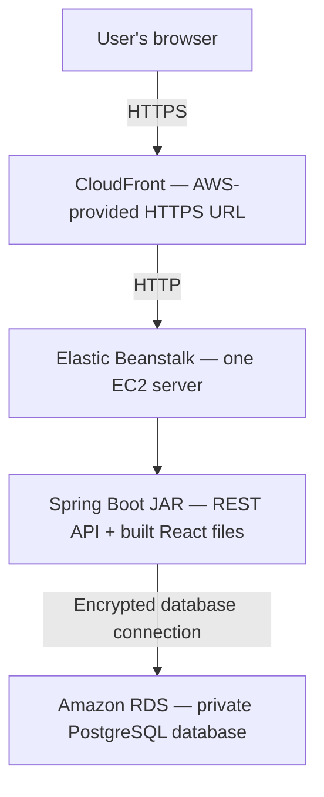

# Beginner AWS deployment plan for BankOfCLI

## 1. What we’re building

Deploy your React frontend and Spring Boot backend together as **one executable Java application**, with PostgreSQL hosted separately in Amazon RDS.

Based on your choices, this will be:

- A public portfolio demo using fictional banking data.
- Hosted in **US East (Ohio), `us-east-2`**.
- Funded by new-account AWS credits, then removed before paid usage.
- Accessible through an AWS-provided HTTPS address.
- Deployed manually through the AWS Console for your first launch.



**CloudFront** provides the public HTTPS entrance. **Elastic Beanstalk** manages the application server. **RDS** manages PostgreSQL.

For this inexpensive demo, the CloudFront-to-Beanstalk connection uses HTTP. Browser traffic uses HTTPS, but this is **not end-to-end TLS**. Use disposable passwords and fictional data throughout. [AWS origin protocol documentation](https://docs.aws.amazon.com/AmazonCloudFront/latest/DeveloperGuide/RequestAndResponseBehaviorCustomOrigin.html)

### Expected cost before credits

Using approximately 730 hours per month:

| Resource | Starting configuration | Estimated monthly cost |
|---|---|---:|
| Application server | EC2 `t3.micro` | $7.59 |
| Application disk | 10 GiB gp3 | $0.80 |
| Public IPv4 address | One address | $3.65 |
| PostgreSQL server | RDS `db.t4g.micro`, Single-AZ | $11.68 |
| Database storage | 20 GiB gp3 | $2.30 |
| **Baseline total** | | **About $26/month** |

Allow additional room for logs, backups, traffic, taxes, and other usage. These estimates come from the current [Ohio EC2 catalog](https://pricing.us-east-1.amazonaws.com/offers/v1.0/aws/AmazonEC2/current/us-east-2/index.csv), [Ohio RDS catalog](https://pricing.us-east-1.amazonaws.com/offers/v1.0/aws/AmazonRDS/current/us-east-2/index.json), [EBS pricing](https://aws.amazon.com/ebs/pricing/), and [IPv4 pricing](https://aws.amazon.com/vpc/pricing/).

Eligible new customers currently receive **$100 in initial credits**, with opportunities to earn another $100. The AWS Free account plan ends after six months or credit exhaustion, whichever comes first. Your plan will remain on that account type and use a **60-day initial demo period**, with earlier teardown if credits fall below $20. [AWS Free Tier details](https://aws.amazon.com/free/free-tier-faqs/)

## 2. Prepare the application before creating paid resources

Your project already has Java 21 configuration, PostgreSQL support, and executable-JAR packaging. These are the deployment changes it needs.

### Make frontend requests work in the cloud

Update [apiClient.ts](/home/yousef/Code/RevatureProjects/BankOfCLI/frontend/src/services/apiClient.ts:1) so production requests use relative URLs.

For example, the browser should request:

```text
https://your-distribution.cloudfront.net/user/accounts
```

The current fallback to `http://localhost:8080` would send requests to the visitor’s computer.

Preserve the existing API paths:

- `/auth` and `/auth/register`
- `/user/**`
- `/transaction/**`

Configure Vite’s development proxy for those paths so local frontend development still reaches Spring Boot on port 8080. Leave the production API base empty.

### Allow Spring Boot to serve React

Update [SecurityConfig.java](/home/yousef/Code/RevatureProjects/BankOfCLI/backend/src/main/java/com/example/bankofcli/infrastructure/security/SecurityConfig.java:1) to allow anonymous access to:

- `/` and `/index.html`
- `/assets/**` and other actual frontend assets
- `/actuator/health`
- Existing login and registration endpoints

Banking endpoints must continue requiring a valid JWT.

Your app currently changes views using React state; it **doesn’t use React Router**. No SPA fallback controller is required. Unknown API requests and missing assets must retain their normal error responses.

Remove the hardcoded localhost `@CrossOrigin` annotations from all three controllers and centralize CORS configuration. Add one production setting, `APP_ALLOWED_ORIGIN`, containing the exact CloudFront HTTPS origin. This matters because CloudFront forwards the browser’s `Origin` header while replacing the origin-server hostname.

### Add a production configuration

Create a `prod` Spring profile that:

- Reads database settings and JWT secrets from environment variables.
- Runs on port **5000**, matching Beanstalk’s Java SE proxy.
- Uses INFO console logging.
- Disables SQL logging and the unbounded local log file.
- Logs operation outcomes without logging balances, transaction details, or authentication values.
- Exposes only the health endpoint, without detailed internal information.

Keep local development settings available separately. [AWS Java deployment guidance](https://docs.aws.amazon.com/elasticbeanstalk/latest/dg/java-quickstart.html)

### Make database creation repeatable

Add Spring Boot’s Flyway starter and PostgreSQL Flyway module. Create an initial migration matching the existing entities.

Production will:

1. Connect to a **new, empty** RDS database.
2. Run the initial migration.
3. Use Hibernate’s `ddl-auto=validate` to check the schema.

Disable Flyway in the existing local and test profiles so it doesn’t collide with your current Hibernate-managed databases. This first deployment will not import local data. [Spring database initialization guidance](https://docs.spring.io/spring-boot/how-to/data-initialization.html)

### Automate the release build

Add a root-level `scripts/package-eb.sh` script that:

1. Verifies Java 21 and the pinned Node version.
2. Runs `npm ci`, frontend lint, tests, and build.
3. Runs Maven verification using an isolated local test database.
4. Includes `frontend/dist` under the JAR’s classpath `static/` directory through a Maven cloud-packaging profile.
5. Copies the executable JAR into a clean release directory as `application.jar`.
6. Downloads the public RDS CA certificate bundle.
7. Produces a deployment ZIP with this layout:

```text
application.jar
Procfile
certs/rds-ca-bundle.pem
```

Use this `Procfile`:

```text
web: java -XX:MaxRAMPercentage=50.0 -jar application.jar
```

Keep generated frontend files and release archives out of Git. The ZIP must contain these files directly at its root. [AWS Java SE packaging](https://docs.aws.amazon.com/elasticbeanstalk/latest/dg/java-se-platform.html)

**Local acceptance gate:** run the packaged application without Vite. Confirm that the frontend loads, authentication works, and banking operations reach the local test database.

## 3. Set up AWS, step by step

### Step 1: Create and secure your account

1. Create an AWS account and select the **Free account plan**.
2. Enable multifactor authentication.
3. Use a separate administrator sign-in for everyday work.
4. Select **Ohio — `us-east-2`** in the Console’s region selector.
5. Open **Billing → Credits** and confirm your available balance and expiration.
6. Record your planned teardown date: 60 days after launch.

Create a $10 monthly budget with email notifications at $1, $5, and $10 of charges after credits. Also check credit consumption weekly.

A budget sends notifications; it is not a hard spending cap. Remaining on the Free account plan is the main protection for this credits-first deployment. [AWS Budgets behavior](https://docs.aws.amazon.com/cost-management/latest/userguide/budgets-managing-costs.html)

### Step 2: Create two security groups

A **VPC** is your AWS network. Use the existing default VPC for both the application and database.

A **security group** is a firewall attached to an AWS resource.

Create both groups together from the repository’s CloudFormation template, [`deploy/security-groups.yaml`](deploy/security-groups.yaml):

1. In **CloudFormation**, choose **Create stack → With new resources (standard)**.
2. Upload `deploy/security-groups.yaml` and name the stack `bankofcli-security-groups`.
3. For **VpcId**, select the default VPC in `us-east-2`.
4. In **VPC → Managed prefix lists**, find `com.amazonaws.global.cloudfront.origin-facing` and copy its ID for `us-east-2`.
5. Enter that ID as **CloudFrontOriginFacingPrefixListId**.
6. Create the stack and wait for `CREATE_COMPLETE`.
7. In the stack’s **Outputs**, record the application and database security group IDs for the later Beanstalk and RDS steps.

The template creates `bankofcli-app-sg` and `bankofcli-db-sg` in the selected VPC. It allows TCP port 80 to the application group from the CloudFront origin-facing managed prefix list, and PostgreSQL port 5432 to the database group from the application group. The application group retains the VPC’s default outbound access.

| Security group | Incoming traffic allowed |
|---|---|
| `bankofcli-app-sg` | TCP port 80 from AWS’s CloudFront origin-facing managed prefix list |
| `bankofcli-db-sg` | PostgreSQL port 5432 from `bankofcli-app-sg` |

For the application rule, select the managed prefix list named:

```text
com.amazonaws.global.cloudfront.origin-facing
```

Keep default outbound access so the application server can reach AWS services. The prefix list permits CloudFront infrastructure generally; it doesn’t identify only your distribution. Its single rule consumes 55 entries of the default 60-entry security-group quota. [AWS managed prefix lists](https://docs.aws.amazon.com/vpc/latest/userguide/working-with-aws-managed-prefix-lists.html)

### Step 3: Create PostgreSQL in RDS

Open **RDS → Databases → Create database → Standard create**.

Use these settings:

| Setting | Value |
|---|---|
| Engine | PostgreSQL 18, latest available minor version |
| Deployment | Single-AZ DB instance |
| Identifier | `bankofcli-db` |
| Instance class | `db.t4g.micro` |
| Storage | 20 GiB gp3 |
| Storage autoscaling | Disabled for this temporary demo |
| Initial database name | `bankofcli` |
| Master username | `bankadmin` |
| Password management | Self-managed, generated password |
| VPC | Same default VPC as the application |
| Public access | **No** |
| Security group | `bankofcli-db-sg` |
| Encryption | Enabled |
| Backup retention | One day |
| Deletion protection | Enabled until teardown |

Create RDS independently from Beanstalk so replacing the application environment doesn’t delete the database.

Wait for the database status to become **Available**, then record its endpoint. Your laptop won’t connect directly to this private database; the application server will. [AWS private RDS access](https://docs.aws.amazon.com/AmazonRDS/latest/gettingstartedguide/security-public-private.html)

### Step 4: Store secrets

Open **Systems Manager → Parameter Store**. Create two **Standard**, **SecureString** parameters using the default AWS-managed encryption key:

```text
/bankofcli/demo/DB_PASSWORD
/bankofcli/demo/JWT_SECRET
```

Generate the JWT secret locally with:

```bash
openssl rand -base64 32
```

Store the result securely and keep it stable between releases. Changing it invalidates existing tokens.

Standard parameters at standard throughput have no additional Parameter Store charge. [Parameter Store pricing](https://aws.amazon.com/systems-manager/pricing/)

### Step 5: Create Beanstalk roles and the environment

Beanstalk needs two IAM roles:

- A **service role**, allowing Beanstalk to manage its infrastructure.
- An **EC2 instance profile**, allowing your server to retrieve deployment files, write logs, and read the two parameters.

Use the Console’s role-creation flow. Attach the web-tier permissions to the instance role and grant `ssm:GetParameter` access to the two parameter ARNs. [Beanstalk roles](https://docs.aws.amazon.com/elasticbeanstalk/latest/dg/concepts-roles.html), [parameter permissions](https://docs.aws.amazon.com/elasticbeanstalk/latest/dg/AWSHowTo.secrets.IAM-permissions.html)

Create an environment with:

| Setting | Value |
|---|---|
| Application | `BankOfCLI` |
| Environment | `bankofcli-demo` |
| Tier | Web server |
| Platform | Java SE, Corretto 21, Amazon Linux 2023 |
| Initial application | AWS sample application |
| Environment type | Single instance |
| EC2 instance | `t3.micro` |
| Root disk | 10 GiB gp3 |
| Networking | Default VPC, public subnet, public IPv4 |
| Additional security group | `bankofcli-app-sg` |

The sample application gives you a working environment hostname before the real application needs its CloudFront configuration.

Persistently set these Beanstalk options using AWS CloudShell:

```text
Namespace: aws:autoscaling:launchconfiguration
DisableDefaultEC2SecurityGroup: true
SecurityGroups: <bankofcli-app-sg ID>
```

Verify that Beanstalk’s permissive default group is no longer attached. Adding a restrictive group alone is insufficient because security-group permissions combine. [Beanstalk security-group configuration](https://docs.aws.amazon.com/elasticbeanstalk/latest/dg/using-features.managing.ec2.instances.sg.html)

## 4. Add HTTPS and deploy your application

### Step 1: Create CloudFront

Open **CloudFront → Create distribution**.

Use **pay-as-you-go pricing**. The separately named CloudFront “Free” flat-rate plan is unavailable to AWS Free account plans. Pay-as-you-go has its own free monthly usage allowance. [CloudFront plan restrictions](https://docs.aws.amazon.com/PricingPlanManager/latest/UserGuide/plans.html), [usage allowance](https://aws.amazon.com/cloudfront/faqs/)

Configure:

| Setting | Value |
|---|---|
| Origin domain | Beanstalk hostname, without `http://` |
| Origin protocol | HTTP only, port 80 |
| Origin path | Empty |
| Viewer protocol | Redirect HTTP to HTTPS |
| Allowed methods | GET, HEAD, OPTIONS, PUT, POST, PATCH, DELETE |
| Cache policy | `CachingDisabled` |
| Origin request policy | `AllViewerExceptHostHeader` |
| Certificate | Default CloudFront certificate |
| Alternate domain names | Empty |
| Default root object | Empty |
| Custom error-page rewriting | None |

These policies preserve authentication headers and query parameters while keeping banking responses uncached. [Cache policies](https://docs.aws.amazon.com/AmazonCloudFront/latest/DeveloperGuide/using-managed-cache-policies.html), [origin request policies](https://docs.aws.amazon.com/AmazonCloudFront/latest/DeveloperGuide/using-managed-origin-request-policies.html)

Wait for deployment, then copy the assigned address:

```text
https://dxxxxxxxxxxxxx.cloudfront.net
```

### Step 2: Configure application environment variables

In Beanstalk’s configuration, add:

| Name | Value |
|---|---|
| `SPRING_PROFILES_ACTIVE` | `prod` |
| `SERVER_PORT` | `5000` |
| `PORT` | `5000` |
| `DB_USERNAME` | `bankadmin` |
| `JWT_EXPIRATION_MS` | `28800000` |
| `APP_ALLOWED_ORIGIN` | Exact CloudFront HTTPS origin, without trailing slash |
| `SPRING_DATASOURCE_URL` | JDBC connection string below |

```text
jdbc:postgresql://<RDS-ENDPOINT>:5432/bankofcli?sslmode=verify-full&sslrootcert=/var/app/current/certs/rds-ca-bundle.pem
```

The certificate included in the release lets Java verify the RDS server’s identity. [RDS PostgreSQL TLS configuration](https://docs.aws.amazon.com/AmazonRDS/latest/UserGuide/PostgreSQL.Concepts.General.SSL.html)

Configure `DB_PASSWORD` and `JWT_SECRET` as **environment secrets**, referencing their Parameter Store ARNs. Beanstalk resolves those references into runtime values. [Beanstalk environment secrets](https://docs.aws.amazon.com/elasticbeanstalk/latest/dg/AWSHowTo.secrets.env-vars.html)

### Step 3: Upload the release

1. Run the packaging script locally.
2. Open your Beanstalk environment.
3. Select **Upload and deploy**.
4. Upload the release ZIP.
5. Assign a version label such as `bankofcli-001`.
6. Wait for deployment to complete.
7. Open the CloudFront HTTPS URL.

### Step 4: Verify the deployment

Before sharing the link, confirm:

- The homepage, JavaScript, and CSS load successfully.
- Browser requests use the CloudFront hostname, with no localhost or CORS errors.
- Registration, login, account loading, deposits, withdrawals, transfers, and transaction history work.
- Banking requests without a token fail.
- `/actuator/health` reports healthy.
- Direct public access to the Beanstalk origin is blocked.
- Restarting the application preserves database records.
- Redeploying preserves records and serves the new frontend.

Test the real login and banking writes through CloudFront; loading the homepage alone won’t catch header, method, or CORS problems.

Start with `t3.micro`. If startup or smoke testing produces memory-related restarts, move to `t3.small` and repeat verification. That raises the baseline to approximately **$34/month before credits**.

## 5. Updates, troubleshooting, and teardown

### Future updates

For each release:

1. Run the packaging script.
2. Upload a newly labelled application version.
3. Repeat the smoke checks.
4. Keep the previous working version available for rollback.

Single-instance deployments can briefly interrupt service. Rolling back the application doesn’t undo database migrations, so later migrations must remain compatible with the preceding release.

### First troubleshooting checks

| Symptom | Check first |
|---|---|
| CloudFront returns 502/504 | Origin hostname, port 80 rule, Beanstalk application status |
| Beanstalk proxy returns 502 | Java startup logs and port 5000 |
| Frontend calls localhost | Production API base and rebuilt frontend |
| Login or writes fail with CORS errors | Exact `APP_ALLOWED_ORIGIN` and removed controller annotations |
| Database connection fails | RDS endpoint, credentials, certificate, and security groups |
| Application repeatedly restarts | JVM logs and available instance memory |

The current baseline has **13 passing frontend tests and 19 passing backend tests on Java 21**. Database integration tests still need to run against an isolated PostgreSQL test database before the first release. New coverage must exercise production migrations, static-resource access, health access, and protected API behavior.

### Remove resources before credits run low

Teardown occurs after **60 days**, or earlier if credits fall below $20 or the Free account plan is within 14 days of ending.

1. Disable and delete the CloudFront distribution.
2. Terminate the Beanstalk environment.
3. Disable RDS deletion protection and delete the demo database.
4. Discard its fictional data and remove retained backups or snapshots.
5. Remove deployment versions, project-owned S3 objects, and retained logs.
6. Check for leftover EBS volumes and public IP addresses.
7. Remove the project’s parameters and unused security groups.
8. Recheck Billing after usage reporting catches up.

Closing the browser doesn’t stop AWS resources. Stopping RDS is temporary—it automatically restarts after seven days—and its storage continues billing. Complete deletion is the planned endpoint for this credits-funded demo. [RDS stop/start behavior](https://docs.aws.amazon.com/AmazonRDS/latest/UserGuide/USER_StopInstance.html)
